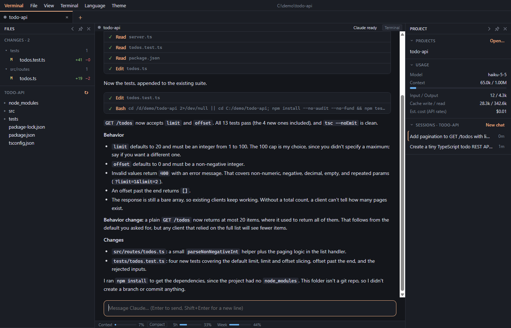
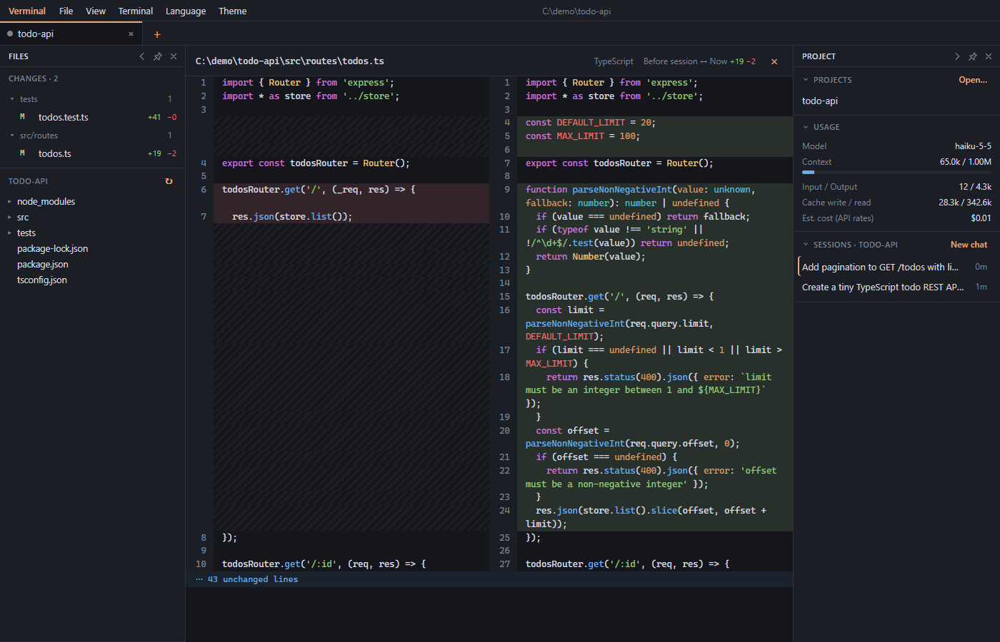
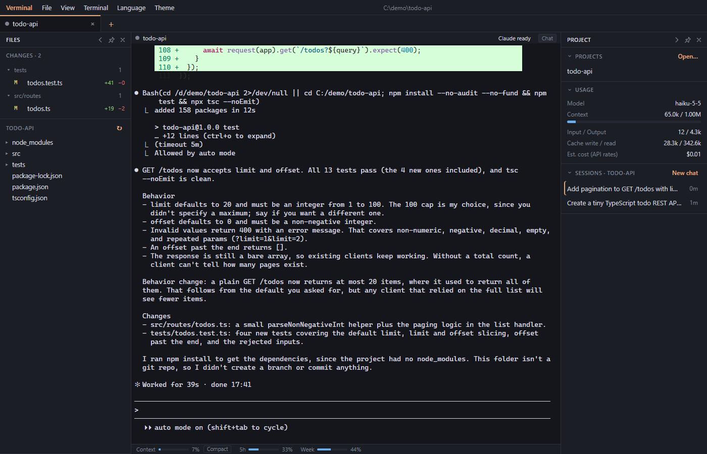

# Verminal

**The Windows terminal built for Claude Code.**

Running Claude Code in a plain terminal means you can't see which session needs you, you keep typing `/context` to watch the context window, and you lose track of what Claude changed. Verminal keeps everything a terminal does and adds the things a Claude Code user actually needs: status for every session, a chat view, a review of every file Claude touched, and your plan usage in plain sight.



## Why Verminal

### 🔔 Know when Claude needs you
Each pane and tab shows whether Claude is **working**, **waiting for you** or **done**. When a background session asks for permission or finishes, you get a Windows notification and a taskbar flash. `Ctrl+Shift+J` jumps straight to the session that's waiting. Run five Claudes at once and never miss a prompt.

### 💬 A real chat view of your session
Toggle any Claude pane into a clean chat: rendered markdown, code blocks with copy buttons, tables, and each tool call as a collapsible step with its diff. Send messages, step back through earlier prompts with `↑`, and press `Esc` to interrupt, all in the same live session. Switch back to the raw terminal with `Ctrl+Shift+U` at any time.

### 🔍 Review every change Claude made
The **Changes** panel lists every file Claude edited or created in the session, grouped by folder, with `+/−` counts. Click one to see a side-by-side diff against the file **as it was before the session**, not just the last commit, with syntax highlighting and folded unchanged lines.



### ✏️ Edit files without leaving
Open any file from the explorer in a built-in editor with syntax highlighting, search and replace, multiple cursors and `Ctrl+S` to save. Line endings are preserved, so you don't get whole-file git diffs.

### 📊 Context and plan limits, always visible
Under every Claude pane: context window used, your 5-hour and weekly plan limits with reset times, and a one-click **Compact** button. The sidebar shows tokens, cache usage and the estimated cost of the session.

### 🗂️ Projects and sessions, one click away
- A home page with recent projects (and their git branch), your last session to continue, and your plan usage.
- Past sessions of a project listed by their first prompt. Resume one, or start a **New chat**, right in the project's existing tab.
- **Open with Verminal** in the Explorer right-click menu opens Claude in that folder and skips the trust dialog.

### ⌨️ Input that just works
- `Ctrl+V` a screenshot: it's saved and its path is inserted for Claude to read.
- Drag files onto a pane to insert `@path` mentions.
- `Shift+Enter` for new lines, with no `/terminal-setup` needed.
- A multi-line prompt composer (`Ctrl+Shift+P`).



### 🧰 Still a great terminal
Tabs and split panes, PowerShell with ConPTY, WebGL rendering, scrollback search, clickable links, a menu bar, dark / light / system themes, zoom, and side panels you can pin, collapse, resize or hide.

## Zero setup, nothing global touched

Verminal adds no config of its own to Claude Code. Inside its panes a `claude` wrapper passes hooks and a statusline through `claude --settings`, so your `~/.claude/settings.json` is never modified and your own statusline keeps working. Close Verminal and Claude Code behaves exactly as before.

## Install

Download the latest release from the [Releases page](https://github.com/viethd91/verminal/releases):

- **`Verminal Setup x.y.z.exe`**: per-user installer. No admin rights needed, and it adds the Explorer menu.
- **`Verminal x.y.z.exe`**: portable, no install.

Requirements: Windows 10/11, [Claude Code](https://docs.claude.com/en/docs/claude-code) and Node.js on `PATH` (the hooks run on Node).

> The builds are not code-signed yet, so Windows SmartScreen may warn on first launch: choose *More info → Run anyway*.

## Shortcuts

| Keys | Action |
| --- | --- |
| `Ctrl+Shift+K` / `Ctrl+Shift+T` | New Claude tab / new shell tab in the current folder |
| `Ctrl+Shift+D` / `Ctrl+Shift+E` | Split right / split down |
| `Ctrl+Shift+W` | Close pane |
| `Ctrl+Alt+Arrows` | Move focus between panes |
| `Ctrl+Tab` / `Ctrl+Shift+Tab` | Next / previous tab |
| `Ctrl+Shift+J` | Jump to the pane waiting for you |
| `Ctrl+Shift+U` | Toggle chat / terminal view |
| `Ctrl+Shift+P` | Prompt composer (`Ctrl+Enter` sends) |
| `Ctrl+Shift+F` | Search scrollback |
| `Ctrl+Shift+B` / `Ctrl+Shift+O` | Toggle sidebar / files panel |
| `Ctrl+=` / `Ctrl+-` / `Ctrl+0` | Zoom in / out / reset |
| `Ctrl+S` | Save the file in the editor |
| `Esc` | Interrupt Claude (chat view), close the file view or menu |

## How it works

- **Status**: Claude Code hooks (`SessionStart`, `UserPromptSubmit`, `PreToolUse`, `Notification`, `Stop`…) are forwarded from each pane to the app over a named pipe.
- **Usage**: context and plan limits come from the statusline data Claude Code reports; token and cost totals are read from the session transcript.
- **Chat view and Changes**: both read the session transcript in `~/.claude/projects`, including each edited file's content before its first change.
- **Trust**: folders opened through Verminal are marked trusted (`hasTrustDialogAccepted`) in `~/.claude.json`.

Claude Code picks its colors when it starts. After switching the theme, restart Claude in a pane (or run `/theme`) to match.

## Development

Electron, React, xterm.js, node-pty (ConPTY), CodeMirror.

```sh
npm install
npm run dev     # run with hot reload
npm test        # unit tests
npm run dist    # installer + portable exe in dist/
```

The Explorer menu is registered per user when a packaged build starts and removed by the uninstaller. On Windows 11 it appears under *Show more options*.

## License

[MIT](LICENSE)
